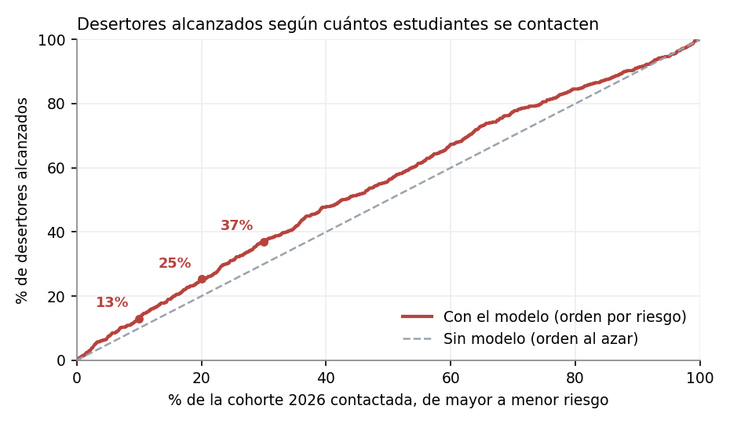

# FUGA IPSS · Detección temprana de deserción estudiantil

**InnovaLab · Instituto Profesional San Sebastián**
Responsable analítico: Fernando Pinto Montecinos · Metodología: CRISP-DM · Versión 0.4 (noviembre 2026)

---

## El problema de negocio

Hoy el IP gestiona la deserción de forma **reactiva**: el equipo de seguimiento llama al estudiante cuando ya dejó de asistir, no entregó evaluaciones o avisó que va a suspender. En ese punto la decisión de irse suele estar tomada.

Este proyecto busca darle a ese equipo una **lista priorizada de estudiantes en riesgo** al ingreso y al cierre del primer periodo. Así puede actuar **antes**, y concentrar sus horas de contacto donde más cambian el resultado.

## Qué entrega el modelo

| Momento de predicción | Información usada | Para qué sirve |
|---|---|---|
| **A · Al ingreso** | Encuesta de caracterización | Priorizar el acompañamiento desde la primera semana |
| **B · Al cierre del primer periodo** | Encuesta, primeras notas, primeros contactos | Reordenar la lista con la conducta académica real |

Cada estudiante recibe una **probabilidad de deserción** y sus **principales factores de riesgo**. El éxito se mide con lo que el equipo puede atender: qué proporción de los desertores queda en el 10% o el 20% de mayor riesgo, y con cuánta anticipación se generó la alerta.

## Estado del proyecto

| Fase CRISP-DM | Estado |
|---|---|
| 1. Comprensión del negocio | ✅ Completada |
| 2. Comprensión de los datos | ✅ Completada |
| 3. Preparación de los datos | ✅ Completada, con etiqueta provisional |
| 4. Modelado | 🟡 Modelo de referencia; la versión definitiva depende de las solicitudes R1 y R2 |
| 5. Evaluación | 🟡 Preliminar: métricas de negocio, estabilidad y equidad |
| 6. Despliegue | ⏳ Propuesta inicial |

### Hallazgos principales

- **3 de cada 10 estudiantes encuestados desertaron** (30,4%; 999 de 3.283 con estado conocido). Desertar significa quedar eliminado o suspendido.
- **La tasa depende de cuánto tiempo lleva cada cohorte**: 45% en 2024 (~31 meses), 22% en 2025 (~18 meses) y 31% en 2026 (~7 meses). La cohorte 2026 tiene más deserción que la 2025 con menos tiempo, lo que sugiere abandono muy temprano o estudiantes que nunca iniciaron clases.
- **La conducta académica anticipa la deserción**: más de la mitad de las evaluaciones de los eliminados tienen nota mínima, contra ~16% en los vigentes.
- **El registro de contactos tiene señal, pero también trampas**: varias señales (el estudiante dice que desiste, contactos de retención) ocurren *cuando* ya se está yendo. Se excluyen como predictores para que el modelo alerte a tiempo y no solo confirme lo que ya pasó.

### Resultados preliminares de la predicción

| | Modelo A · al ingreso (solo encuesta) | Modelo B · cierre del 1er periodo (+ notas y contactos) |
|---|---|---|
| Validación | Entrenado con 2024–2025, aplicado a la cohorte 2026 | Validación cruzada, cohorte 2024 |
| Desertores alcanzados contactando al 20% de mayor riesgo | **25%** (128 de 505; al azar: 20%) | **41%** (A en la misma cohorte: 24%) |
| % de alertados que efectivamente desertó | 39% (promedio de la cohorte: 31%) | **85%** |
| AUC | 0,57 | 0,75 |

**Lectura:** la encuesta de ingreso prioriza mejor que el azar, pero poco. La conducta del primer periodo casi duplica la capacidad de anticipar la deserción, así que el producto con más valor es una **alerta al cierre del primer periodo**. El modelo de ingreso además alerta de forma desigual por jornada, sexo y nacionalidad, y eso debe corregirse antes de usarlo con estudiantes individuales. El detalle está en el [informe del proyecto](docs/02_informe_proyecto/).



### Qué falta para el modelo definitivo

El estado académico es una foto en una fecha de corte, sin la **fecha en que cada estudiante desertó**. Sin esa fecha no se puede fijar un horizonte de predicción (por ejemplo, deserción en los primeros 12 meses) ni garantizar que el modelo use solo información anterior al evento. Las solicitudes a Registro Académico están en el [registro de decisiones](docs/registro_decisiones.md#solicitudes-a-registro-académico). Las críticas son **R1**, el historial de estados con fecha, y **R2**, la fecha de corte del estado.

## Documentación

| Documento | Ubicación |
|---|---|
| Resumen ejecutivo | [`docs/01_informe_ejecutivo/`](docs/01_informe_ejecutivo/) |
| Informe del proyecto | [`docs/02_informe_proyecto/`](docs/02_informe_proyecto/) |
| Diccionario de variables | [`docs/03_diccionario_variables/`](docs/03_diccionario_variables/) |
| Documentos técnicos y de avance | [`docs/04_documentos_tecnicos/`](docs/04_documentos_tecnicos/) |
| Registro de decisiones, problemas abiertos y solicitudes | [`docs/registro_decisiones.md`](docs/registro_decisiones.md) |
| Notebook CRISP-DM (registro académico del análisis) | [`notebooks/01_fuga_crisp_dm.ipynb`](notebooks/01_fuga_crisp_dm.ipynb) |

## Estructura del repositorio

```
FUGA_IPSS/
├── data/                  # Datos de estudiantes: NO se versionan
│   ├── raw/               #   archivos de origen entregados por el IP
│   ├── interim/           #   log de contactabilidad limpio
│   └── processed/         #   tabla base con la variable objetivo
├── docs/                  # Informes, diccionarios y registro de decisiones
├── notebooks/             # Análisis exploratorio y documentación CRISP-DM
├── src/fuga_ipss/         # Pipeline de producción (mismo proceso que el notebook)
│   ├── config.py          #   supuestos y reglas de negocio en un solo lugar
│   ├── contactabilidad.py #   limpieza del log del SGE e indicadores de texto
│   ├── encuesta.py        #   unificación de cohortes
│   ├── rendimiento.py     #   indicadores académicos por estudiante
│   ├── objetivo.py        #   variable objetivo y tabla base
│   ├── pipeline.py        #   ejecución de punta a punta
│   ├── features.py        #   selección de predictores desde el diccionario
│   └── modelo.py          #   entrenamiento y evaluación de negocio y equidad
├── tests/                 # Pruebas con datos sintéticos
├── models/                # Modelos entrenados (no versionados)
├── reports/               # Resultados agregados del modelo y gráficos
└── openspec/              # Especificaciones de cambios (desarrollo guiado por specs)
```

## Cómo ejecutarlo

```bash
python -m venv .venv && source .venv/bin/activate
pip install -e ".[dev]"
nbstripout --install          # el notebook se versiona siempre sin salidas

# Copiar los archivos del IP en data/raw/ y luego:
python -m fuga_ipss.pipeline  # genera data/interim y data/processed
python -m fuga_ipss.modelo    # entrena, evalúa y genera reports/ y la lista priorizada
pytest                        # pruebas
```

El pipeline reproduce exactamente las cifras del notebook: 38.616 interacciones, 3.303 estudiantes y 30,4% de deserción. Los supuestos de negocio, como la fecha de corte, la definición de deserción y los patrones de texto, se cambian en `src/fuga_ipss/config.py`.

## Privacidad y uso responsable

- Los estudiantes se identifican con un código pseudonimizado (`EST-…`). **Ningún dato a nivel de estudiante se versiona**: `data/`, `*.pkl`, `*.csv` y los Excel de origen están en `.gitignore`.
- El notebook se guarda sin salidas (filtro `nbstripout`), porque las salidas pueden mostrar identificadores o textos de las observaciones.
- Las variables sensibles de la encuesta (nacionalidad, situación migratoria, pueblo originario, discapacidad, salud, identidad de género, entre otras) se evalúan por sesgo antes de decidir si entran al modelo.
- La lista de riesgo es una herramienta de **apoyo** al equipo de seguimiento, no una decisión automática sobre el estudiante.

---
Proyecto desarrollado para InnovaLab, Instituto Profesional San Sebastián.
